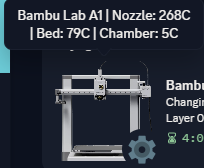

# BambuPresence

A lightweight, pure-Go desktop application that connects to your Bambu Lab 3D printer over local LAN MQTT and broadcasts live print status to Discord Rich Presence.

## Screenshots

Live print status with ETA countdown, layer progress, and printer model image:


Customizable presence fields (toggle filename, layers, remaining time, temperatures, filament, and errors):


Printer model and live temperatures on hover:



## Features
  - Automatic printer model detection and model image from serial number (X1C, X1E, P1P, P1S, A1, A1 mini, H2D).
  - ETA countdown timer or elapsed print timer.
  - Active AMS/external spool filament info (material, color name, remaining %, slot).
  - HMS error decoding and filament runout / hardware pause alerts.
  - Option to hide presence when idle.
  - Windows toast notifications on print completion, pause, and HMS errors.

## Setup

1. Enable **LAN Only Mode** (or get your LAN Access Code and Serial Number) on your Bambu Lab printer.
2. Create a Discord application in the [Discord Developer Portal](https://discord.com/developers/applications) and copy its **Application ID (Client ID)**.
3. Run `BambuPresence.exe` (or `go run .`).
4. Enter your **Printer IP**, **Access Code**, **Serial Number**, and **Discord Client ID** in the Settings panel, then click **Connect**.

## Building from Source

Requires Go 1.24+

Windows:
```powershell
$env:CGO_ENABLED="0"
go build -ldflags "-H=windowsgui" -o BambuPresence.exe .
```
Linux:

乁( ͡° ͜ʖ ͡°)ㄏ

